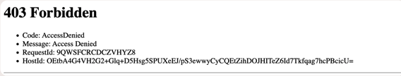
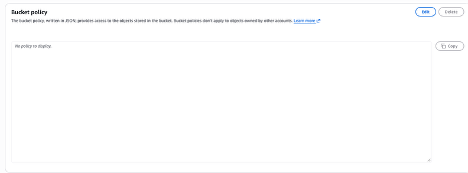
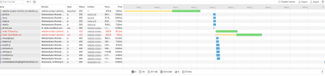
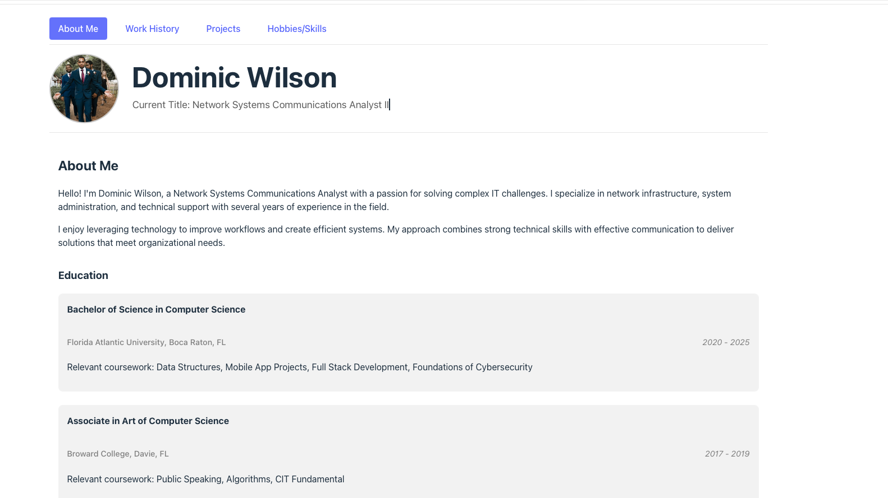

# AWS S3 Static Website Hosting Project 

## Project Summary 
This project demonstrates the deployment of a React/Vite website using Amazon S3 Static Website Hosting. The application was built locally, deployed to AWS S3, and configured for public access. During deployment, issues related to file structure and access permissions were identified and resolved. 


Link: http://website-project-dominic.s3-website.us-east-2.amazonaws.com
(Link DOESN'T NOW)
---

## Technologies Used 
- React
- Vite
- Amazon S3
- Safari Web Inspector 

---

## Architecture

```text
Local React/Vite Application
            │
            ▼
      npm run build
            │
            ▼
        dist folder
            │
            ▼
      Amazon S3 Bucket
            │
            ▼
  Static Website Hosting
            │
            ▼
      Public Website
```

---

## Lab Objectives Completed

- Created an Amazon S3 bucket for static website hosting. 
- Uploaded HTML, image, JavaScript, and CSS files to the S3 bucket. 
- Configured Amazon S3 Static Website Hosting. 
- Enabled public access to website content using S3 permissions and bucket policies. 
- Deployed a personal React/Vite portfolio website using Amazon S3. 
- Validated website accessibility through the S3 website endpoint. 
- Used Safari Web Inspector to troubleshoot website loading issues. 
- Identified and resolved HTTP 403 Access Denied errors. 
- Implemented an S3 bucket policy to allow public read access to website resources. 
- Successfully published a functional public website accessible via the internet.

---
## Deployment Process

1. Built the React/Vite application using:

```bash
npm run build
```

2. Generated a production-ready `dist` folder. 

3. Uploaded the contents of the `dist` folder to an Amazon S3 bucket configured for Static Website Hosting. 

4. Configured the bucket's index document settings. 

5. Verified website accessibility through the S3 Website Endpoint. 

---
## Challenges Encountered

### Issue 1: Incorrect File Structure

Initially, the entire `dist` folder was uploaded instead of the contents of the folder. As a result, S3 could not properly locate the website resources. 
### Incorrect Structure

```text
website-project-dominic/
└── dist/
    ├── index.html
    ├── assets/
    ├── logo.png
    └── profile-picture.jpeg
```

### Correct Structure

```text
website-project-dominic/
├── assets/
├── index.html
├── logo.png
├── profile-picture.jpeg
└── vite.svg
```

### Issue 2: HTTP 403 Access Denied Errors

The website displayed a blank page even though the HTML document loaded successfully. Safari Web Inspector revealed that the JavaScript and CSS assets were returning HTTP 403 errors. 


---


Deployment Troubleshooting Screenshot 
Safari Network tab showing the 403 errors for JavaScript and CSS assets before the bucket policy was configured. 





Figure: Safari Web Inspector Network tab showing successful document loading alongside 403 errors for application assets. These errors indicated that the React application resources were blocked by S3 access controls and guided the implementation of the bucket policy fix.


Bucket Policy Fix Implemented 
The 403 Access Denied errors were resolved by applying the following S3 bucket policy, which grants public read access to all objects in the bucket: 
 
```json
{ 
  "Version": "2012-10-17", 
  "Statement": [ 
    { 
      "Sid": "PublicReadGetObject", 
      "Effect": "Allow", 
      "Principal": "*", 
      "Action": "s3:GetObject", 
      "Resource": "arn:aws:s3:::website-project-dominic/*" 
    } 
  ] 
} 
 ```

 ---

## Results

After correcting the deployment structure and applying the bucket policy:

- Website loaded successfully
- JavaScript assets loaded correctly
- CSS assets loaded correctly
- Portfolio website became publicly accessible
- Static website hosting was successfully configured



---

## Skills Demonstrated

### AWS

- Amazon S3
- Static Website Hosting
- Bucket Policies
- Public Access Configuration

### Web Development

- React
- Vite
- Production Builds
- Static Asset Management

### Troubleshooting

- Safari Web Inspector
- Network Analysis
- HTTP Status Code Troubleshooting
- Access Control Validation
- Root Cause Analysis

---

## Project Attribution

This project was completed using the AWS S3 Static Website Hosting lab provided by NextWork(https://nextwork.ai/dominic-wilson/docs/70e2d059-31ab-5f67-8c58-f5edbd451140). The guided lab supplied the deployment objectives and AWS workflow.

The application deployed during this project was my personal React/Vite portfolio website. Additional troubleshooting and validation activities were performed independently, including:

- Browser-based troubleshooting with Safari Web Inspector
- Analysis of HTTP 403 errors
- S3 bucket policy configuration
- Verification of asset accessibility
- Validation of successful website deployment

---

## Personal Contributions

- Built and maintained the React/Vite portfolio website.
- Generated production builds using Vite.
- Deployed application files to Amazon S3.
- Diagnosed and resolved deployment issues.
- Configured S3 bucket policies.
- Validated successful website deployment.
- Documented troubleshooting findings and corrective actions.

---

## Outcome

Successfully deployed a fully functional React/Vite portfolio website using Amazon S3 Static Website Hosting, resolved S3 permission issues, and gained hands-on experience with cloud hosting, access control, and web application deployment troubleshooting. 

---
## DEMO
<video controls src="images/Screen Recording 2026-10-13 at 8.58.44 PM.mov" title="Title"></video>

---